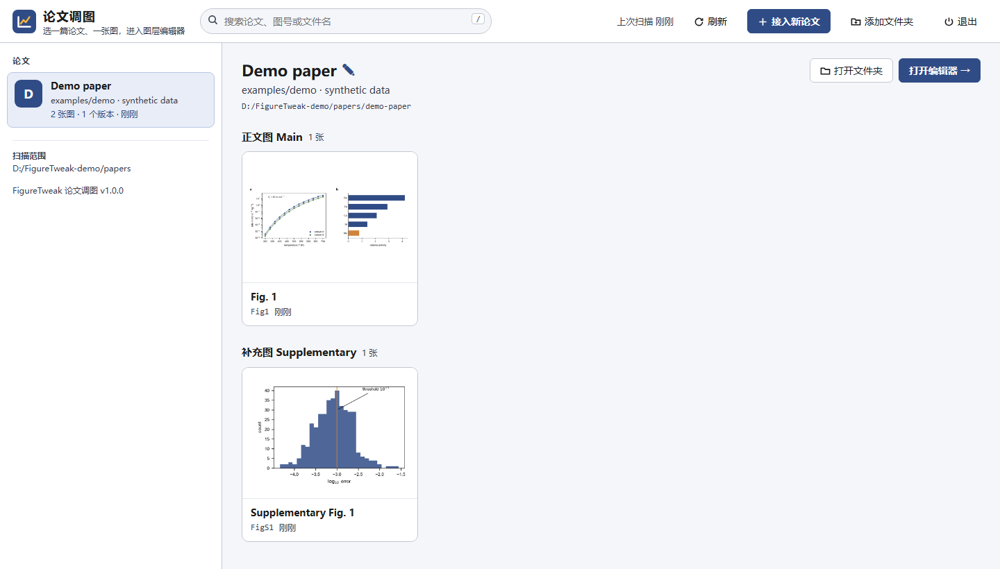
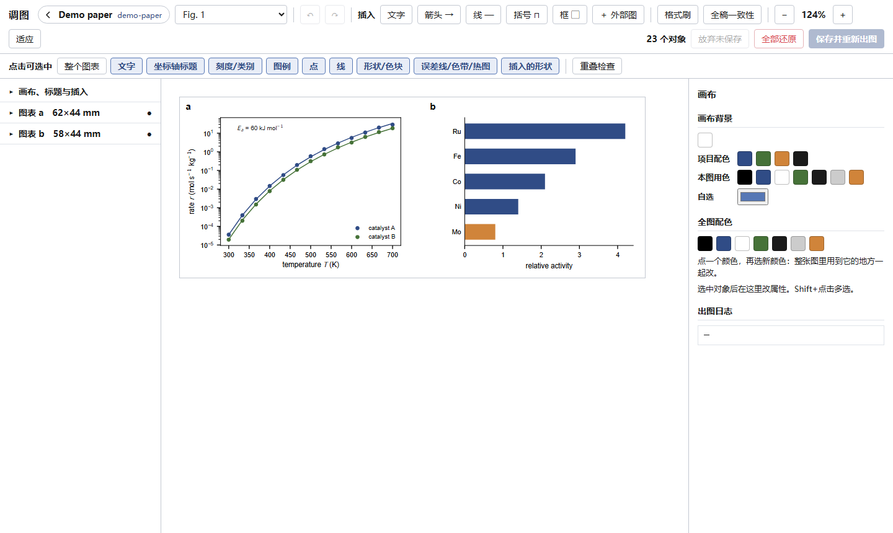

# FigureTweak · 论文调图

用代码画的 matplotlib 论文图，在浏览器里像 BioRender 一样手动微调：图层、属性、配色、拖放。
**手动调整存成数据**（`<图名>.tweaks.json`），每次重新出图自动套用，所以脚本始终是唯一的源头，重跑永远不会丢掉手改。





## 下载

从 [Releases](../../releases/latest) 下载 `FigureTweak.exe`（Windows，单文件，无需安装）。双击打开，或把论文的图文件夹拖到它上面。

出图仍用你自己的 Python（装有 matplotlib 的那个），程序只负责界面和调度。

## 能做什么

- **论文列表**：自动扫描电脑上所有可编辑的论文图，按论文分组（git 仓库；每个 worktree 是一个版本），带缩略图，按正文图 / 扩展数据图 / 补充图分组，可搜索，可改显示名称。
- **一键接入新论文**：选论文的图所在文件夹，程序会在 `Page.save` 里加两行调用 `tweak.apply`，放入 `tweak.py`，逐个重新出图并**逐像素比对**原 PNG，生成图号表 `figure_labels.json`。
- **图层编辑器**：移动、缩放整个图表（分图字母跟着走）；移动、改写、改字号、加粗、对齐、旋转任意文字和刻度；插入文字、箭头、引线、显著性括号、圆角框；单个对象或整图换色（旧色 → 新色，配色编码不乱）；线宽、透明度、显示/隐藏；多选对齐分布、吸附参考线、重叠检查、撤销重做、格式刷；常用快捷键（Ctrl+A / Ctrl+D / 方向键微移 / Delete / Ctrl+S）在顶栏「?」里。
- **有框线 / 无框线**：每个图表可选有框线（四边）、无框线（只留两条坐标轴）、无轴线；图中带框的标注可整图去掉边框和白底，或单个去掉边框只留白底。画布里设一次管整张图，一个按钮用到全稿所有图，随时切回。
- **Origin 式坐标轴与图层工具**：坐标轴起止范围、线性/对数、主刻度间隔、次刻度开关、刻度朝内/朝外、网格线；在数据坐标上加参考线（可带标注）；图例边框开关和九宫格位置；鼠标所在处的数据坐标读数（数据读取器）；线型、虚线段长、标记形状/大小/空心、色带与色标范围。
- **新建图表（图表模板）**：43 种科研图表（含雷达图、山脊图、云雨图、桑基图、韦恩/UpSet、三元相图、PCA、等高线、火山图等），按“比较 / 排序 / 组成 / 分布 / 关系 / 多变量 / 趋势 / 区间 / 集合 / 催化”筛选；导入 CSV 或从 Excel 粘贴，选好对应的列，用论文自己的 style.py 预览，生成 `make_图名.py` + `图名_data.csv` 后直接进入编辑器。生成的是普通脚本，可以照常修改。
- **数据与系列**：顶栏「数据」读出图表里画出的数值，表格里改（可从 Excel 粘贴）；在已有图表上「添加系列」（柱、折线、散点、面积，可带误差棒，柱子可与原有的并排）；模板做的图还能直接改源数据表、改图表设置或换图表类型。数值改动和添加的系列都记在 `<图名>.tweaks.json`，脚本不动。
- **全稿一致性检查**：跨图比较分图字母、标题、坐标轴标题、刻度、图例的字号，一键统一。
- **叠加外部图**：在别处来的 SVG 上直接加标注。

## 让图可以编辑

编辑器认这种写法：图画在 `Page`（毫米排版的 matplotlib figure）上，最后 `pg.save(HERE, "Fig1")`，而 `Page.save` 在 `savefig` 前调用 `tweak.apply`：

```python
def save(self, here, stem, rerun_args=None):
    import tweak                            # hand adjustments from <stem>.tweaks.json (figure editor)
    tweak.apply(self.fig, here, stem, rerun_args)
    for ext in ("svg", "pdf", "png"):
        self.fig.savefig(os.path.join(here, "%s.%s" % (stem, ext)), dpi=600, facecolor=self.fig.get_facecolor())
```

不用手写——在程序里点「接入新论文」即可。可以拿 [`examples/demo`](examples/demo) 试：它是一个还没接入的小例子（合成数据），接入后两张图都能编辑。

要点：SVG 文字保持为文字（`svg.fonttype: "none"`）；脚本里的文字串保持稳定（文字的键就是它的内容）；`*.tweaks.json` 和 `*.tweak_keys.json` 随图一起提交。

不用 `Page` 也行：任何 matplotlib 写法（`plt.subplots`、subfigures、constrained/tight 布局、pandas 画图、双轴、极坐标、3D、内嵌图）只要在 `savefig` 前调用 `tweak.apply(fig, HERE, "FigS7")`，并按原尺寸保存（不用 `bbox_inches="tight"`）。写完跑一次自检，按提示改掉每条 ERROR：

```
python tweak.py --check <图文件夹> FigS7 --rerun
```

## 给 AI 助手用的 skill

[`skill/figure-tweak/SKILL.md`](skill/figure-tweak/SKILL.md)：让 Claude Code 等助手在写图脚本时保持图可编辑、帮你接入论文、排查编辑器问题。复制到 `~/.claude/skills/figure-tweak/` 即可。

## 从源码运行 / 构建

```bash
pythonw figuretweak/figure_hub.py            # 打开论文列表
pythonw figuretweak/figure_hub.py <文件夹>    # 直接打开这篇论文，没接入的话进入接入向导
pwsh -File build.ps1 -Python <装有 pyinstaller 和 pillow 的 python>   # 构建 dist/FigureTweak.exe
```

推送 `v*` 标签时，GitHub Actions 会构建 exe 并附到对应的 Release 上。

配置在 `%LOCALAPPDATA%\figure_hub\`：`papers.json`（扫描哪些文件夹、论文显示名，默认值见 [`figuretweak/figure_papers.json`](figuretweak/figure_papers.json)）、`config.json`（页面上添加的文件夹、改过的名称、上次打开的图）。

---

**English.** FigureTweak is a local browser editor for hand-adjusting code-generated matplotlib paper figures. Edits are
saved as data next to each figure and re-applied whenever the script re-renders, so the script remains the source of
truth. Download `FigureTweak.exe` from Releases, run it, and use "接入新论文" (onboard a paper) on the folder with your
`style.py` and figure scripts.
